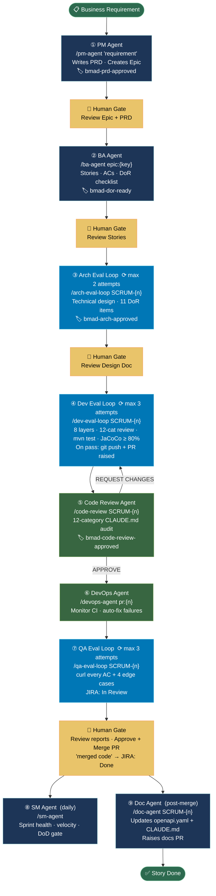
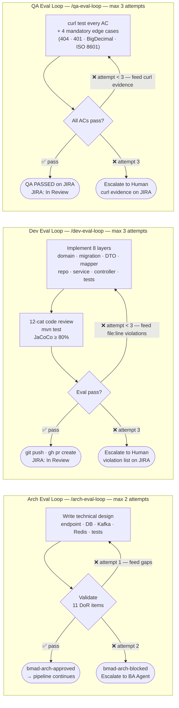
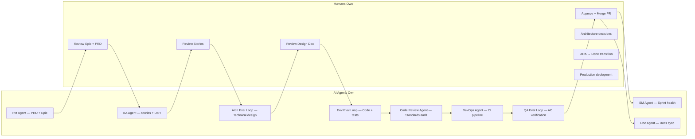

# BMAD Pipeline Diagrams
# Render at: https://mermaid.live  (paste each code block)

---

## Diagram 1 — High-Level Pipeline Overview

---

## Diagram 2 — Eval Loop Retry Logic (all three loops)

---

## Diagram 3 — Human Governance Model

